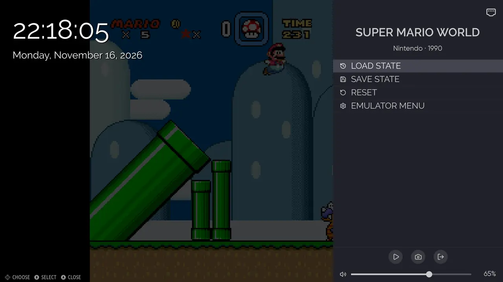
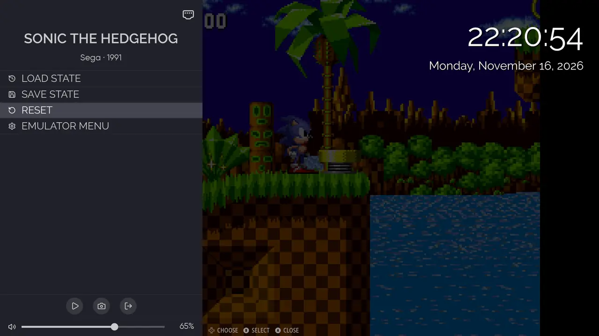
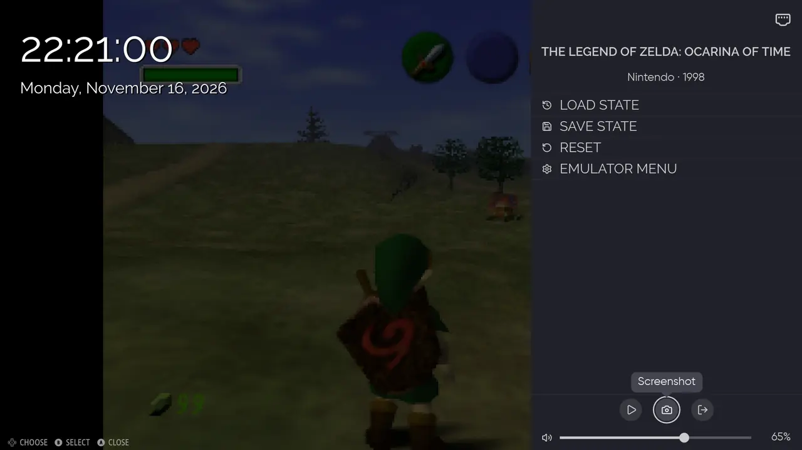
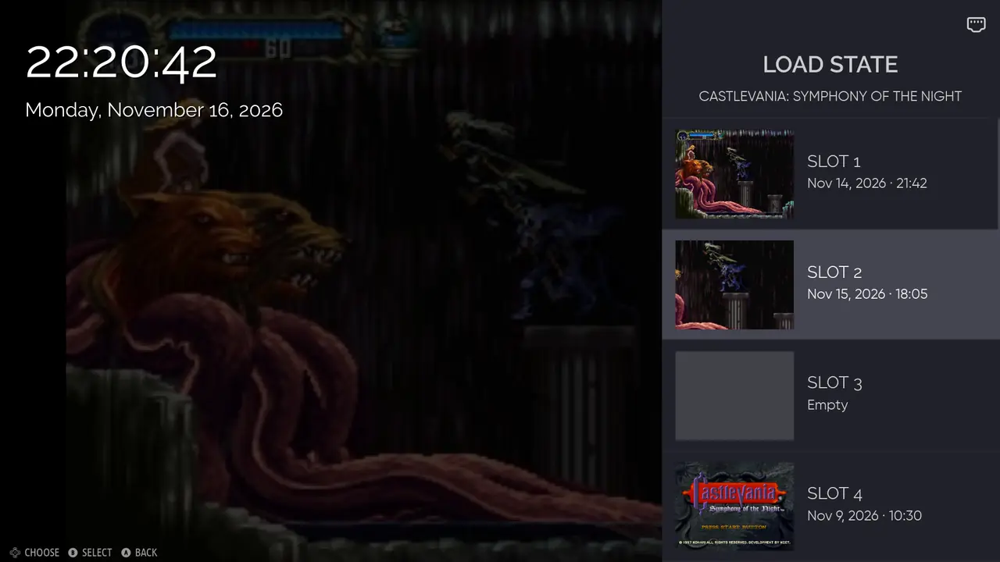
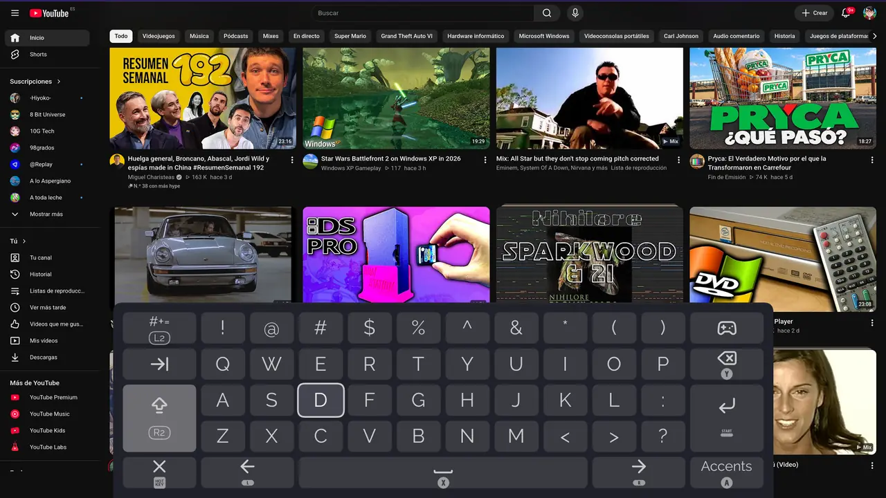
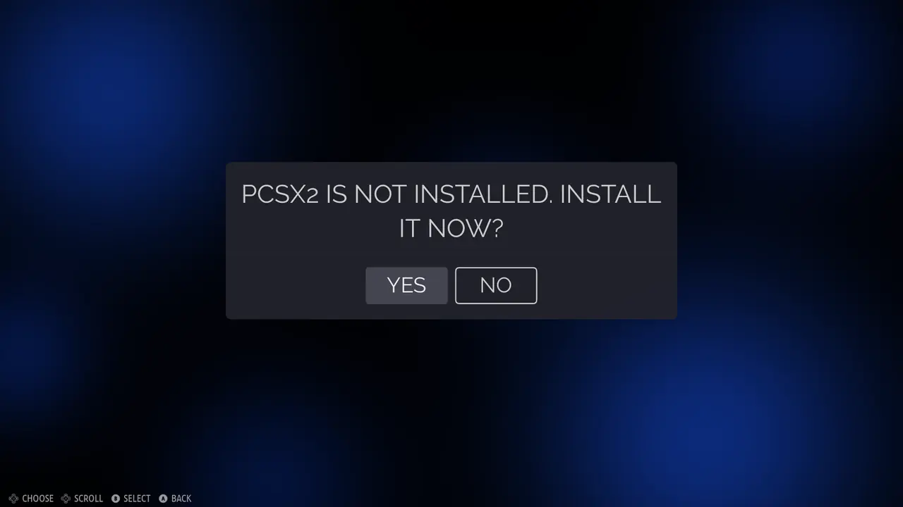
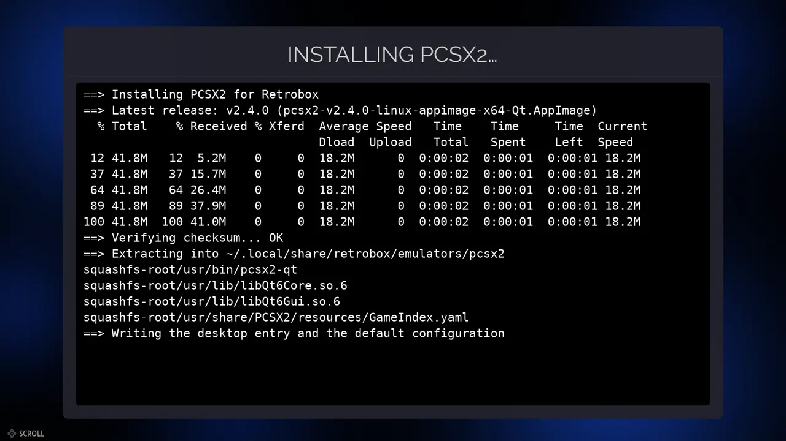
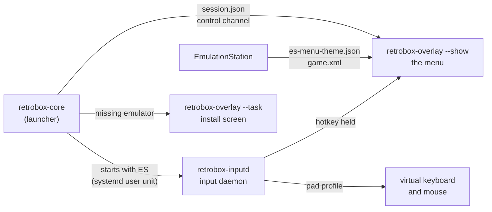

# retrobox-overlay

The in-game menu of [Retrobox](https://github.com/RetroboxProject/retrobox-core), and the
input daemon that opens it and maps controllers to keys.



Tap the controller's **Home/Guide** button (**Hotkey+A** where the hotkey is Select) or press
**Ctrl+Shift+O** while
playing: a side menu slides in over the dimmed game, drawn in the menu style of the active
EmulationStation theme, with a clock on the other side. From there you load and save states,
read the game's manual, reset, change the volume or the brightness, or leave the game.

It is a small Rust program (a few MB, about 35 ms from the button to the menu on screen). The
only thing that stays resident is a daemon that reads the controllers and keyboards; the menu
runs only while it is shown.

**Contents:** [Features](#features) · [Controls](#controls) ·
[How it fits in Retrobox](#how-it-fits-in-retrobox) · [Requirements](#requirements) ·
[Settings](#settings) · [Building](#building) · [License](#license)

## Features

### The in-game menu

* **The game at the top:** its name, developer and year (from EmulationStation's scraped
  information), and a status line with the time played this time (the game's page has it in
  all), the network, the battery and, if wanted, the time.
* **The game's page** (*Game info*): its scraped picture, developer, publisher, release date,
  genre, players, rating, times and time played, and its description.
* **The controls page** (*Controls*), for a game with a pad-to-keyboard profile: each mapping
  with its buttons (EmulationStation's help icons) and what it does, its description if it
  has one; the keys it presses are lit on EmulationStation's keyboard and mouse.
* **The achievements page** (*Achievements*), when RetroAchievements is on in EmulationStation
  and it knows the game: every achievement with its badge, title, description and points,
  earned ones first, and how many are earned. They come from RetroAchievements (through
  `curl`) the first time the page opens; the badges are cached.
* **What the emulator can do,** each with its icon: load and save state, reset, the emulator's
  own menu, the disc tray and next/previous disc. The launcher tells the overlay what the
  running emulator supports; anything it cannot do is not shown.
* **Round buttons** pinned at the bottom, where the menu opens: *continue*, *quit* (*save and
  quit* where the game's auto save/load is on: held, its ring fills and, once full, it quits
  without saving) and *system* (*Power off…*, which opens the power options, and the other
  system options). A button highlighted for a second explains itself in a small bubble.
* **Sliders** for the volume and, on a built-in screen, the brightness, as tall as the
  buttons' row.
* **Sounds** for moving, choosing and going back, like EmulationStation's, when its
  *Enable navigation sounds* option is on (Retrobox's EmulationStation has it on by default);
  the toasts' sounds follow it too. `[sounds]` in `overlay.ini` sets their volume, or turns
  them off.
* **Break reminder:** after two hours playing, and then every half hour, a toast at the top
  of the screen (on the menu's side, in its colours) suggests a break, with a sound, and goes
  away on its own a few seconds later. `[break]` in `overlay.ini` sets when, or turns it off.
  Other programs can show toasts too (see [Toasts](#toasts)).
* **The theme's look:** colours, fonts, selector and help prompts come from the theme
  EmulationStation is using, scaled to the screen. Without one it looks like ES's default
  menus.
* **Either side of the screen** (`side = left` in `overlay.ini`), a big or small clock, taller
  rows for touch screens.

| Menu on the left (Sonic the Hedgehog) | A button explaining itself (Ocarina of Time) |
|---|---|
|  |  |

The game keeps running underneath: like Steam's overlay, the menu does not pause it (most
console games have a pause of their own, and the emulator's menu pauses the rest).

### Save states



*Load state* and *Save state* open a page of ten slots (0 to 9), each with the picture and the
date RetroArch saved with it. They are RetroArch's own files, the same ones EmulationStation
lists. Where the game's *auto save/load* is on (EmulationStation's option, global, per system
or per game), RetroArch loads its automatic state (`.state.auto`, the auto save
EmulationStation lists) on start, and *quit* becomes *save and quit*: tapped, it saves that
state and quits; held until its ring is full, it quits without saving and forgets the state;
let go before that, it does nothing. With the option off, *quit* only quits. RetroArch never
saves the automatic state by itself.

### Discs

Games of a platform with an optical drive (Mega-CD, Saturn, PlayStation, Dreamcast...) always
have the tray entry, which also reaches the console's BIOS menu. A game of several discs (an
`.m3u` playlist) shows the disc in the drive and offers next/previous disc, which work with the
tray open, as on Batocera.

### Instruction manuals

When the game has a scraped manual (a PDF), the menu offers *Instruction manual*: a page viewer
that works like EmulationStation's, with zoom, scrolling and page turning from the controller,
the keyboard or the mouse.

### Volume, audio devices and brightness

* **Volume** of the default output (PipeWire or PulseAudio). Confirm on the slider (or a click
  off its track) mutes it.
  The slider follows changes made anywhere else at once.
* **Audio page** (X on the volume slider, or F2): choose the output device and its card's
  profile (stereo, headset, HDMI...), system-wide.
* **Brightness** of a laptop's or a handheld's own screen, when it is the main one. It glides to
  the new value instead of jumping, and never goes fully black.
* With EmulationStation's *Right analog stick changes volume* option on (the default), the
  right stick sets the volume wherever the selection is in the main menu.

### Volume keys

`retrobox-overlay --volume up|down|mute` is a volume key: it steps the default output's volume
by 5 % (never above 100 %) or mutes and unmutes it, with PipeWire or PulseAudio alike. Retrobox's
labwc session binds the keyboard's volume keys (and a handheld's buttons) to it. With
`toast = true` in `[volume]` (off by default: desktops show their own), each press also shows
the volume at the top of the screen, on the menu's side: its icon and a bar like the menu's
slider. The toast takes no input at all, follows the presses that come after the first, and goes
3 seconds after the last one; it does not show while the menu is open (its slider does). With
the overlay open the volume keys still work: if the compositor hands them to it rather than
running its bindings, the menu's slider moves (or mutes) with them, and the on-screen keyboard
changes the volume as above, without a toast.

### Outside games

In EmulationStation, Kodi or anything else that is not a game, the same button opens the
system's menu, like the Switch's quick settings: the *System* button (*Power off…*, *update
system*) and the volume and brightness sliders. In what Kodi starts with `retrobox-launch` (it
publishes a game session), the menu is a game's, as anywhere else.

### Power options

*Power off…* closes the menu and opens the power options: *sleep mode*, *restart* and
*turn off*, in a popup in the middle of the dimmed screen, in the menu's style (the System
button opens them at once when the System page would have nothing else). Back (the east
button, Esc), a click or a tap outside, or the right button close it. They are also there
on their own, for a power button: `retrobox-overlay --power` asks the input daemon for them
(SIGUSR2), which closes the menu first if it is open, or closes them if they are the ones
shown; without the daemon, the command shows them itself. Bind it to the power key (labwc's
`rc.xml`: `<keybind key="XF86PowerOff"><action name="Execute" command="retrobox-overlay
--power"/></keybind>`, with `HandlePowerKey=ignore` in logind's configuration so that it does
not turn the machine off first). Toasts give way to them as to the menu, and the volume keys
keep working. They go through systemd (`systemctl`) or, with another init, elogind
(`loginctl`); with neither, there are no power options.

*Update system* is there when the machine has Retrobox's system settings program
(retrobox-system-settings: `[core] system_settings` of `retrobox.ini`, else
`retrobox-system-settings` in the `PATH`) and it says it can (`update available`): a
console. It opens the task screen, which asks first, then shows what the update prints as it
goes (`<program> update run`: `retrobox-update` as root), and says when it is done or why it
failed. On a Nintendo Switch with nx-debian's `/usr/bin/nxd-update` the update is that one,
run with `pkexec`, whatever the system settings program says. An ordinary computer,
without that program, is updated its own way, and the option is not there.

On a Nintendo Switch running switchroot's Linux, the System page also has the
performance profiles of its NVIDIA applet (*Console*, *Handheld*, *OC CPU*, *OC GPU*,
*OC All*, *Perf All*, *Perf OC All*, as `nvpmodel`'s configuration names them), in games too,
the one in use ticked. The Switch is told by its device tree (a `nintendo,…` compatible board;
an ARM board has no DMI for `dmidecode`), the profiles come from `/etc/nvpmodel.conf` (else
the chip's `/etc/nvpmodel/nvpmodel_t210.conf` or `nvpmodel_t210b01.conf`), and a change runs
`pkexec /usr/sbin/nvpmodel -m N`, which the applet's polkit policy lets the active session do
without a password. The profile stays after a restart, as with the applet.

The menu stays away while a game is starting or ending: it does not open from the moment a
game is chosen until its emulator runs (an emulator to install still gets its install screen),
nor from the moment the game is quit until the launcher is done, and closes if it was open.

### On-screen keyboard



**Hotkey+Y** in an app that needs typing (the web browsers) slides up a keyboard in the menu's
colours, without dimming the app. It types with the active keyboard layout (symbols and
accented letters included) on a virtual keyboard, so the app never loses the focus.

* The d-pad or stick moves over the keys, the south button types, Y is backspace, X space,
  Start enter, L and R move the cursor, R2 is shift, L2 the symbols, A the accents, Home
  closes it (button names as EmulationStation's, in SNES layout; each key shows its button).
* The **right stick** makes it bigger or smaller (10 % to 75 % of the screen's width) and **R3**
  moves it between the bottom and the top of the screen. Both are remembered.
* A physical keyboard works too, and a tap outside the keyboard closes it.

### Toasts

A toast is a short notice at the top of the screen, on the menu's side and in its colours: an
icon, a title and a line or two, with one of the menu's sounds. It shows over whatever runs
(a game, EmulationStation) without taking the keyboard or the controllers, and goes away on its
own. The break reminder is one; any program can show others:

```sh
retrobox-overlay --toast --title "Controller disconnected" --icon gamepad-2 --sound back
retrobox-overlay --toast --title TEXT [--text TEXT] [--icon NAME]
                 [--sound select|back|scroll|none] [--seconds N]
```

`--icon` is the name of one of the overlay's icons, its file's in
[`assets/icons`](assets/icons) (Remix Icon's or Lucide's), with or without a Remix Icon's `-line`
(`trophy`, `coffee`, `information`, `gamepad-2`...); the texts are shown as given (the caller
translates them). Toasts never overlap:
one asked for while another shows waits for it to go (a lock in the runtime directory). None
shows while the overlay is open: opening it takes the one on screen away first (the volume's
too), so the menu comes up alone, and the ones asked for meanwhile are dropped, not kept for
later.

Achievements are not toasts: RetroArch, PCSX2, Dolphin and Flycast announce unlocks themselves,
as soon as they happen, with the badge. Showing them
here would mean polling RetroAchievements (late, and rate-limited) or reading each emulator's
log, and two notices for every unlock.

### Installing and downloading

| Asking first | Installing |
|---|---|
|  |  |

When Retrobox needs something it has not got (the emulator a game needs, or the default theme,
bezels and shaders before EmulationStation starts), it shows this screen over its background
picture: a question in EmulationStation's style, then the installer's output in a terminal
(white on black, at least 80 columns). What asks for something, such as sudo's password, gets
the keyboard's keys, as in any terminal. Hold **L1+R1** (or **Ctrl+Shift**) while a game starts
to be offered its emulator's installation again, to update it.

### Pad-to-keyboard mappings

While a game runs, the daemon maps each player's controller to keys, mouse and commands with
the game's profile, which Retrobox composes from its own and the standard hotkeys
(Hotkey+Start to leave, Hotkey+X for a screenshot...). The profiles are evmapy's `.keys` files
with gamepadly's additions, read exactly as gamepadly read them: this replaces gamepadly.

<details>
<summary>Profile format and details</summary>

* Each controller gets its player's mappings (`actions_player<N>`, else `mappings`), bound to
  its buttons by its `es_input.cfg` entry (numbered as SDL's evdev driver numbers them); every
  keyboard gets `actions_keyboard`.
* `key` mappings hold a key chord or a mouse button while the trigger is held, `exec` mappings
  run a command, `mouse` and `scroll` move the pointer and the wheel with a stick (`speed`,
  `deadzone`, `acceleration`).
* Triggers can be combinations (`mode: all`), any of several inputs (`any`) or a `sequence`,
  with `hold`, `condition` (inputs held as well), `cooldown`, `tap` (fires on release, alone
  and within 300 ms, Retrobox's tap everywhere; not on the hotkey, whose tap opens the overlay) and `_disabled`. The longest combination a press completes wins.
* Keys and mouse buttons go to a virtual keyboard and mouse (`/dev/uinput`, the `input`
  group); commands run in the background. Nothing is grabbed, so the game gets every input
  too; when the overlay opens (it grabs the controllers) what the mappings held is let go.
* The launcher names the profile in `session.json` (`pad_profile`); without it nothing is
  mapped.

</details>

## Controls

| | Controller | Keyboard | Mouse and touch |
|---|---|---|---|
| Open | Home/Guide (tapped), or Hotkey+A where the hotkey is Select | Ctrl+Shift+O (or Shift+F7) | |
| Move | D-pad, left stick | Arrows | Hover, wheel, drag |
| Choose | South button | Enter | Click, tap |
| Quit without saving (auto save/load on) | South button held on *save and quit* | Enter held | Held click |
| Quit at once (as a tap on quit) | X on any round button (Home then X) | | |
| Back, close | East button, Home | Esc | Right click, click outside |
| Entries ↔ buttons | R1 / L1 | Page Down / Page Up | |
| Sliders | Left / Right (held repeats) | Left / Right | Tap or drag the track |
| Volume anywhere | Right stick | | |
| Audio page | X on the volume slider | F2 | |

Buttons follow each controller's `es_input.cfg` entry; EmulationStation's *Switch confirm &
cancel buttons* swaps the south and east buttons, as in ES. Home/Guide opens the menu when it
is tapped alone (let go within 300 ms): where its `es_input.cfg` entry gives the hotkey an input
of its own; nothing else opens it there. On a controller without one the hotkey is Select,
which belongs to the game: there it never taps, and Hotkey+A opens the menu. A controller ES
does not know gets both (Select+A, and Home/Guide's tap). Hotkey+B is RetroArch's own menu,
on every controller. Pressing anything else (or pushing a stick) while
the hotkey is down makes that press no tap, so its other combinations never open the menu.

The buttons of a shortcut stay out of the game: RetroArch and EmulationStation block their
input while the hotkey is held, and with a standalone emulator the input daemon takes the
controller while Home/Guide is held alone (until it goes up, or the menu opens). Emulators that
read some controllers' raw HID device instead of evdev (SDL does for a few) still see them.

## How it fits in Retrobox



The package has two programs:

* **`retrobox-inputd`**, the input daemon. Retrobox starts it with EmulationStation and stops
  it when it ends. It reads every controller and keyboard without grabbing them (but a
  controller's for as long as its Home/Guide is held, with a standalone emulator), opens the
  overlay when asked and, during a game, does the pad-to-keyboard mappings. It has no screen.
* **`retrobox-overlay`**, everything with a screen, each a short-lived process: the menu
  (`--show`, started by the daemon), the on-screen keyboard (`--osk`) and the install screen
  (`--task`, started by the launcher).

What they read:

* **`session.json`** (Retrobox's runtime directory): the running game, its controllers, the
  pad profile and the launcher's **control channel**, through which the overlay asks for
  things (load a state, change the disc...). The launcher does them the best way the emulator
  allows: RetroArch's command pipe, a key chord on a virtual keyboard, or a command.
* **`es-menu-theme.json`**: the menu theme EmulationStation resolved (colours, fonts and
  their sizes, help prompts), exported by Retrobox's EmulationStation build. The last one is
  kept for when there is none yet.
* **`/tmp/game.xml`**: the game's scraped information, exported by EmulationStation at launch,
  with the time played before (`gametime`); `session.json`'s `start_time` gives this time's.
* **`kblayout.svg`**, among EmulationStation's resources: the keyboard of the controls page.
* **RetroAchievements**: the account comes in `session.json` (`achievements`), the game's id
  in `game.xml` (`cheevosId`, else `cheevosHash`, which EmulationStation finds when
  achievements are on); the badges are kept in `~/.cache/retrobox/achievements`.
* **`launch.json`** (runtime directory): whether a game is starting, running or ending,
  written by the launcher for as long as it runs. The menu does not open, and closes, while a
  game starts or ends.

<details>
<summary>How Retrobox runs the daemon</summary>

The daemon lives as long as Retrobox. On systems with systemd, Retrobox starts the user unit
`retrobox-inputd.service` (installed in `/usr/lib/systemd/user/`, never enabled: nothing starts
it at login) and stops it when it ends. Before starting it, Retrobox writes
`$XDG_RUNTIME_DIR/retrobox/inputd.env` with the display (`WAYLAND_DISPLAY`, `DISPLAY`, `XDG_*`)
and `RETROBOX_PARENT_PID`. systemd restarts the daemon if it crashes, logs it to the journal
(`journalctl --user -u retrobox-inputd`) and, when it stops, takes the overlay and the
mappings' commands with it. Without systemd, Retrobox runs `retrobox-inputd --parent PID`
itself. Either way the daemon stops on its own when Retrobox's process ends (a pidfd; every two
seconds on kernels without them), so a Retrobox that crashed never leaves it behind.

`retrobox-overlay --daemon`, what older launchers run, starts `retrobox-inputd` too.
`retrobox-overlay` started on its own asks the daemon to open or close the overlay (SIGUSR1);
only one overlay or keyboard runs at a time (`overlay.lock`), and a second start closes it.

</details>

<details>
<summary>Command line of the install screen</summary>

    retrobox-overlay --task --label NAME --log FILE [--check FILE] [--background PNG]
                     [--pad DEVICE]... [--lang CODE] [--download | --reinstall | --update]
                     -- COMMAND [ARGUMENT]...

`--check` is a file the command must leave (a command that works but leaves nothing has
failed; the background, when not given, is Retrobox's `emusetup/background.png`, from
`~/.config/retrobox`, `/etc/retrobox` or the install's `share/`); `--reinstall` offers to install again what is installed; `--update` asks whether to
update the system (the System page's *Update system*); `--download` runs at once and closes
when it works. Exit status: 0 done, 10 declined or cancelled, 11 failed (the output
stays until closed), 12 no screen. The full output is saved in the log file. A selection made
with the pointer is copied when it ends (Ctrl+Shift+C copies it or all the output, Ctrl+Shift+A
selects it all), with `wl-copy`, `xclip` or `xsel`.

`retrobox-overlay --held` exits with 0 while a controller has L1 and R1 held, or a keyboard
Ctrl and Shift: how the launcher is asked to offer an emulator's installation again.

</details>

<details>
<summary>Technical notes: Wayland, X11 and the cost on the game</summary>

* **Light on the game.** The dim is a single pixel the compositor stretches over the screen
  (`wp_single_pixel_buffer` and `wp_viewporter`), a redraw only hands over the rows that
  changed, and slider changes reach the system at most every 50 ms. Some cost stays: while any
  surface is over a fullscreen game, the compositor composites the game's frames instead of
  showing them directly, as with Steam's overlay.
* **The game comes first.** The overlay, and the programs it starts (the sound player, the
  tools it reads the system with), run at a lower CPU priority (nice 10): opening does a lot at
  once, which on a small machine (a Nintendo Switch) would otherwise take the cores from the
  game for a moment and make its audio stutter. A silent toast starts no sound player at all.
* **No more frames than the screen shows.** The menu, the keyboard and the task screen (its
  output scrolled or selected) draw a new frame only once the compositor has shown the last one
  (its frame callback): a finger dragging the list moves more often than the screen refreshes,
  and every frame costs the game an upload. X11 tells
  nothing of the kind: there a window gets at most one frame per 60 Hz refresh, and only the rows
  that changed are sent to the server. Sliding in draws nothing again (the compositor configures
  the surfaces at every step, with the same size), and the text's shaping and the icons'
  rendering are kept from one frame to the next.
* **Cheap frames.** Images drawn at their size (icons, badges, the controls' keyboard, the
  game's page, which scrolls as one picture) are copied in a plain loop rather than through
  tiny-skia's general pipeline, several times slower; save state previews are scaled once, when
  the page opens; the menu draws over its last frame instead of a new one; and the frame goes
  to the compositor as it is drawn (`ABGR8888`) when it reads that format, with no per-pixel
  conversion. The task screen draws its window and output box (rounded rectangles over most of
  the screen) once per layout, and finds the cell under the pointer by arithmetic: its font is
  fixed-width.
* **The game keeps the focus.** Opened from a controller, the overlay does not take the
  keyboard (`take_keyboard = auto`): many games slow down when they lose the focus. Opened
  from the keyboard it takes it, and closes when another window gets it (Alt+Tab).
* **No window animations on top.** Under KDE Plasma the surfaces use the `on-screen-display`
  namespace, which KWin's open and close effects leave alone; elsewhere it is
  `retrobox-overlay`.
* **X11:** override-redirect windows on the primary monitor, typed as on-screen displays. The
  overlay grabs the keyboard and raises itself when another window is restacked above it, and
  gives the focus back to the game on closing. Without a compositing manager the dim is a
  darkened copy of the screen.
* **Manuals** are rendered by poppler's `pdftoppm` in a thread, ahead of the page on screen,
  and kept in memory (up to 128 MB). The compositor crops and scales the page
  (`wp_viewporter`), so zooming draws nothing; `scaling = overlay` in `[manual]` does it in the
  overlay instead, for compositors that show scaled buffers wrong.
* **Brightness:** the kernel's backlight in sysfs (retrobox-core's udev rule lets the `video`
  group write it), else logind (`busctl`), else `brightnessctl`. The main screen is the only one
  on, else X11's primary output, KDE's (`kscreen-doctor`) or the one the overlay shows on.
* **Volume:** `wpctl` or `pactl`; changes elsewhere are followed through `pw-dump --monitor`
  or `pactl subscribe`, never polled.
* **Status line:** read from sysfs every second; a controller's battery is left out.

</details>

## Requirements

* A Wayland compositor with `wlr-layer-shell` (KWin, labwc, sway and other wlroots
  compositors), or an X11 server. Without layer-shell (GNOME) it falls back to X11 through
  XWayland. `wp_alpha_modifier` (KWin 6.1+, labwc 0.9+) adds the fade-in.
* retrobox-core and retrobox-emulationstation (the packages depend on both).
* Read access to `/dev/input/event*` and `/dev/uinput` (the `input` group).
* Optional: `poppler-utils` for the manuals; `wpctl`/`pw-dump` (PipeWire) or `pactl`
  (PulseAudio) for the volume and the audio page, `pw-cat` or `pacat` for the sounds; `busctl` or `brightnessctl` for the
  brightness when sysfs is not writable; `kscreen-doctor` on KDE Wayland with several screens.

## Settings

`overlay.ini` in `/etc/retrobox` and `~/.config/retrobox` (the user's file wins, key by key).
[`data/overlay.ini`](data/overlay.ini) lists every key with its default:

| Section | What |
|---|---|
| `[overlay]` | side of the menu, dim (0 to 1: opaque black), animation length, `take_keyboard`, icons |
| `[clock]` | on/off, big or small, position, colour, `strftime` formats |
| `[status]` | the battery's percentage |
| `[system]` | whether *Sleep mode* (the power options) and, on a Nintendo Switch, the performance profiles (the System page) are offered |
| `[sounds]` | the volume of the menu's sounds (0: none) |
| `[volume]` | `toast`: show the volume when the volume keys change it (off) |
| `[break]` | when a break is suggested: `after_min` of play (120; 0: never), then `every_min` (30; 0: once) |
| `[touch]` | `row_scale`: taller rows for touch screens |
| `[manual]` | who scales the manual's pages |
| `[osk]` | keyboard layout, and the on-screen keyboard's size and edge (saved for you) |

Day and month names follow the language: EmulationStation's when one is chosen there, else the
system's. Available in English, Spanish, Catalan, Galician, Basque, Portuguese, French, Italian,
German, Dutch, Polish and Russian.

## Building

A Cargo workspace: the overlay (this package, `src/`), the input daemon
(`crates/retrobox-inputd`) and what both share (`crates/retrobox-input`: finding the devices,
`es_input.cfg` and `es_settings.cfg`, paths, locks, logs).

```bash
cargo build --release          # target/release/retrobox-overlay and retrobox-inputd
cargo test && cargo clippy     # what CI checks (clippy pedantic, warnings are errors)
cargo deb --no-build           # .deb  (cargo install cargo-deb)
cargo generate-rpm             # .rpm  (cargo install cargo-generate-rpm)
```

It needs `libxkbcommon` (with its development files to build). GitHub Actions build the `.deb`
and `.rpm` for amd64 and arm64 on every `v*` tag and publish them with a `SHA256SUMS` file.

To try it by hand: `RUST_LOG=debug retrobox-overlay --demo` shows the menu without a game, from
a Wayland or X11 session; `RUST_LOG=debug retrobox-inputd` runs the daemon. When not run from a
terminal they log to `~/.local/state/retrobox/logs/` (`overlay.log`, `inputd.log`), or to the
journal under systemd.

### Diagnosing performance

With `RETROBOX_OVERLAY_TRACE=<file>`, the overlay appends a timeline of what it does to that file:
every touch and pointer event (with how late it was handled), scroll step, frame drawn or put
off (what drawing it, filling the buffer, hashing its rows and committing or, on X11, sending
it took), configure and frame callback (how long the compositor took to show the frame, and its
own frame times), and on X11 whether a compositing manager runs and each time the overlay raised
itself over another window. `scripts/probe.py` samples the system meanwhile: each thread of every
process that used the CPU, and always of the game, the display server, the window manager or
compositor and the overlay (CPU use, time spent waiting for a core, preemptions), each core's
use and frequency and, where the kernel tells them (Tegra's L4T among others), the GPU's load and
frequency, the memory controller's frequency and the temperatures. `scripts/trace_report.py`
puts both together, while dragging, while open and not dragging, and before the overlay opened
(the game alone):

```sh
systemctl --user set-environment RETROBOX_OVERLAY_TRACE=/tmp/overlay-trace.log
systemctl --user restart retrobox-inputd   # the overlay it starts inherits it
sudo scripts/probe.py --out /tmp/probe.log # Ctrl+C when done (root: the GPU's clocks)
scripts/trace_report.py /tmp/overlay-trace.log --probe /tmp/probe.log
systemctl --user unset-environment RETROBOX_OVERLAY_TRACE
```

Both files use `CLOCK_MONOTONIC` in milliseconds, the clock of the compositor's own event times.

The screenshots use game pictures from the
[libretro thumbnails](https://github.com/libretro-thumbnails/libretro-thumbnails) and the colours
and fonts of the [*es-theme-iconic*](https://github.com/manu-creative-411/es-theme-iconic) theme.

## License

GPL-3.0-only.

The menu icons are [Remix Icon](https://remixicon.com)'s (4.5.0, outlined style, Apache License
2.0) and a few of [Lucide](https://lucide.dev)'s (ISC license), redrawn to match; see
[`assets/icons/NOTICE`](assets/icons/NOTICE) for which is which, the licenses next to it, and
the few that are changed for the overlay. The sounds are the
[iconic-es-de](https://github.com/Siddy212/iconic-es-de) theme's, by Siddy212
([`assets/sounds/LICENSE`](assets/sounds/LICENSE)).
